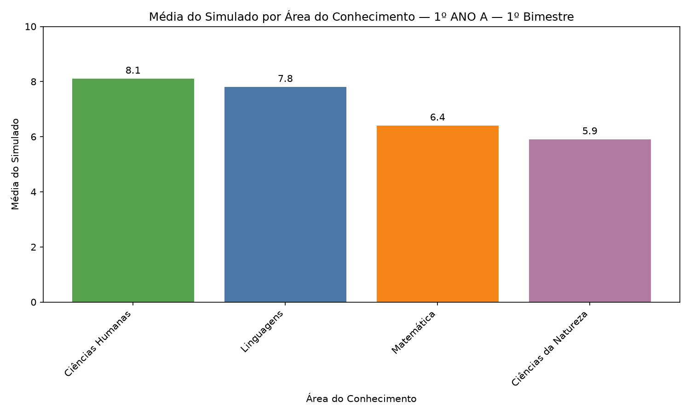

<details open>
<summary><b>🇧🇷 pt-br</b> — create-chart</summary>
<br>

# create-chart

Skill do Claude que transforma uma planilha de notas escolares em um gráfico de barras por turma.

## Por quê

Fazer à mão um gráfico por turma, todo bimestre, para o simulado ou as notas bimestrais de uma escola é uma tarefa repetitiva. Aqui entra uma planilha e sai um .zip com os gráficos.

## Como funciona

O script lê a planilha e encontra cada bloco de turma pelo cabeçalho "ÁREAS DO CONHECIMENTO", depois desenha um gráfico de barras por turma: área do conhecimento contra média, do maior para o menor. Cada barra usa a cor de fundo da célula da disciplina na planilha. Os arquivos PNG e um .zip com eles são gravados na pasta de saída.



O gráfico acima foi gerado a partir de uma planilha sintética, com turmas e notas inventadas.

## Entrada esperada

Um arquivo `.xlsx`, `.xlsm` ou `.numbers` em que cada turma é um bloco: o nome da turma numa célula, o cabeçalho "ÁREAS DO CONHECIMENTO" logo abaixo e uma linha por disciplina com a média. Os blocos são achados por esse cabeçalho, e não por posições fixas, então podem estar empilhados ou lado a lado em qualquer aba. Veja o `SKILL.md` para o layout exato.

## Rodando os scripts diretamente

A partir da raiz do repositório:

```bash
pip install -r requirements.txt

python3 skills/create-chart/scripts/generate_charts.py notas.xlsx \
  --titulo "Média do Simulado por Área do Conhecimento" \
  --bimestre "1º Bimestre" \
  --output-dir charts
```

Argumentos:

- `spreadsheet` (posicional): caminho da planilha de entrada.
- `--titulo` (obrigatório): `"Média do Simulado por Área do Conhecimento"` ou `"Média Bimestral por Área do Conhecimento"`.
- `--bimestre` (obrigatório): qualquer forma como `3`, `3 bimestre` ou `3º`, normalizada para `3º Bimestre`.
- `--output-dir`: onde os PNG e o .zip são gravados (padrão `charts`).

O script imprime o caminho do .zip.

## Usando como skill do Claude

Copie esta pasta para `~/.claude/skills/` ou envie como skill personalizada. Ela só roda quando chamada pelo nome e pergunta o título e o bimestre antes de gerar qualquer coisa.

## Stack

Python, matplotlib e openpyxl para ler arquivos `.xlsx` e `.xlsm`. Ler arquivos `.numbers` exige o pacote opcional `numbers-parser`. As cores de tema do .xlsx são lidas com `zipfile` e `ElementTree` da biblioteca padrão.

</details>

---

<details>
<summary><b>🇺🇸 en</b> — create-chart</summary>
<br>

# create-chart

A Claude skill that turns a school grades spreadsheet into one bar chart per class (turma).

## Why

Making one chart per class by hand, every bimester, for a school's simulado (mock exam) or bimonthly grades is a repetitive manual task. Here a spreadsheet goes in and a .zip of charts comes out.

## How it works

The script reads the spreadsheet and finds each turma block by its "ÁREAS DO CONHECIMENTO" header, then draws one bar chart per turma: knowledge area against average, sorted from highest to lowest. Each bar takes the background color of its subject's cell in the spreadsheet. The PNG files and a .zip of them are written to the output folder.


The chart above was generated from a synthetic spreadsheet with made-up classes and grades.

## Expected input

A `.xlsx`, `.xlsm` or `.numbers` file where each turma is a block: the turma name in a cell, an "ÁREAS DO CONHECIMENTO" header right below it, then one row per subject with its average. Blocks are found by that header rather than by fixed positions, so they can be stacked or placed side by side in any sheet. See `SKILL.md` for the exact layout.

## Running the scripts directly

From the repository root:

```bash
pip install -r requirements.txt

python3 skills/create-chart/scripts/generate_charts.py grades.xlsx \
  --titulo "Média do Simulado por Área do Conhecimento" \
  --bimestre "1º Bimestre" \
  --output-dir charts
```

Arguments:

- `spreadsheet` (positional): path to the input spreadsheet.
- `--titulo` (required): one of `"Média do Simulado por Área do Conhecimento"` or `"Média Bimestral por Área do Conhecimento"`.
- `--bimestre` (required): any phrasing such as `3`, `3 bimestre` or `3º`, normalized to `3º Bimestre`.
- `--output-dir`: where the PNG files and .zip are written (default `charts`).

The script prints the path of the .zip.

## Using it as a Claude skill

Copy this folder into `~/.claude/skills/`, or upload it as a custom skill. It only runs when invoked by name, and it asks for the titulo and the bimester before generating anything.

## Stack

Python, matplotlib, and openpyxl to read `.xlsx` and `.xlsm` files. Reading `.numbers` files needs the optional `numbers-parser` package. The .xlsx theme colors are read with the standard library's `zipfile` and `ElementTree`.

</details>
